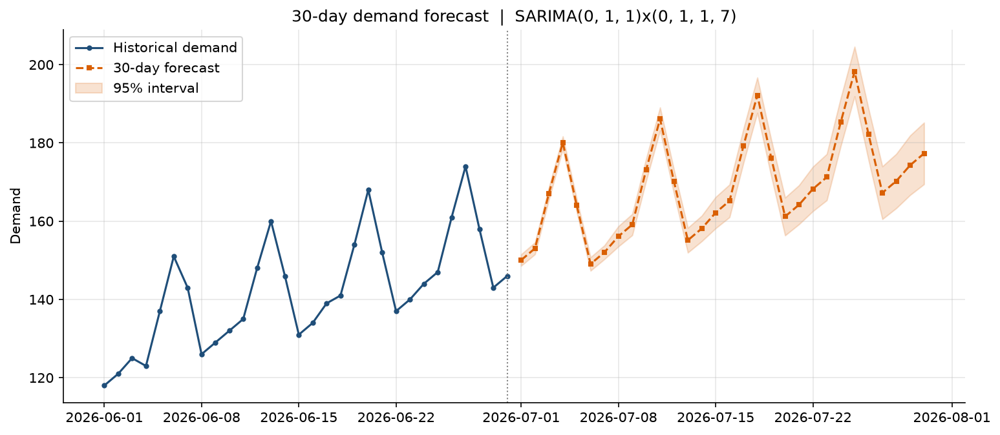

# Time-Series Forecasting with ARIMA

An end-to-end forecasting pipeline for daily demand: decomposition, stationarity testing, SARIMA model selection, evaluation on a test split, and a 30-day forecast.

Built only on the provided dataset, `data/daily-demand-series.csv` (30 daily observations, 1-30 June 2026). No external data is used.

## What the notebook covers

| Step | Method |
|---|---|
| Decomposition | Additive trend / weekly seasonality / residual (`seasonal_decompose`, period 7) |
| Stationarity | Augmented Dickey-Fuller and KPSS tests on the original, differenced and seasonally differenced series |
| Model | SARIMA with d = 1, D = 1, m = 7; p, q, P, Q chosen by AIC grid search on the training split |
| Evaluation | MAPE and RMSE on the final 7 days, compared with naive and seasonal-naive baselines |
| Diagnostics | Residual plots, ACF, Q-Q plot, Ljung-Box test |
| Forecast | Model refit on all 30 days, 30-day projection with 95% intervals |

## Results

Selected model: **SARIMA(0,1,1)x(0,1,1,7)**

| Model | MAPE (%) | RMSE |
|---|---|---|
| SARIMA(0,1,1)x(0,1,1,7) | 0.33 | 0.62 |
| Seasonal naive | 3.92 | 6.02 |
| Naive | 8.25 | 17.03 |

Demand shows a clear upward trend (about 6.7 units per week) and a strong weekly cycle that peaks on Friday and Saturday. The forecast projects 1-30 July 2026.



## Project structure

```
.
├── data/
│   └── daily-demand-series.csv
├── notebooks/
│   └── time_series_forecasting.ipynb   # main deliverable (with outputs)
├── outputs/
│   ├── figures/                        # all plots as PNG
│   ├── forecast_30_day.csv
│   ├── model_metrics.csv
│   ├── hyperparameter_search.csv
│   └── stationarity_tests.csv
├── requirements.txt
└── README.md
```

## How to run

```bash
pip install -r requirements.txt
jupyter notebook notebooks/time_series_forecasting.ipynb
```

Run all cells from top to bottom. Figures and CSV outputs are regenerated in `outputs/`.

## Limitations

- Only about four weekly cycles of history are available, and the test split is a single week, so the accuracy figures are encouraging but not strong evidence.
- The 95% intervals are narrow because June is very regular; real-world uncertainty is likely larger.
- `marketing_event` and `holiday` are not model inputs. They repeat weekly in this data and are already captured by the seasonal terms.
- Prophet was not used; it needs far more history than 30 days to be reliable.
